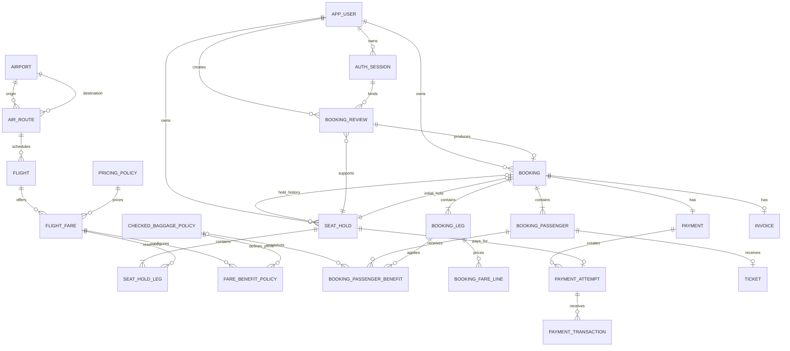

# Thiết kế dữ liệu quan hệ SkyGo

## 1. Phạm vi và nguồn

Thiết kế cho MariaDB/InnoDB, dựa trên `mo_ta_nghiep_vu.docx`, `api-contract.docx` và các quy tắc người dùng bổ sung: chọn sân bay theo khu vực và quốc gia; 5 lần đăng nhập sai liên tiếp trong cùng 15 phút thì khóa đăng nhập 15 phút; phải đăng nhập trước khi chọn chuyến và hạng vé; mỗi tài khoản chỉ có một lượt giữ chỗ đang hoạt động; giữ chỗ tối đa 15 phút; giá Phổ thông theo cự ly, giá Thương gia bằng 2,5 lần giá Phổ thông, mua thêm hành lý theo người/chiều và tính VAT 10% trên tiền vé cộng hành lý chưa VAT. Các quyết định nghiệp vụ mới thay thế phần giá, phí và mua thêm hành lý cũ trong API contract; contract cần cập nhật trước khi triển khai API. Schema hành lý được cập nhật bằng Flyway V4; API mua thêm hành lý được triển khai riêng sau đó.

Mô hình hỗ trợ chuyến bay thẳng của một hãng duy nhất, một chiều hoặc khứ hồi, ba nhóm hành khách, hai hạng vé, quyền lợi theo người và chiều, thanh toán PayOS bằng QR, vé và hóa đơn. Một đơn thuộc một tài khoản, có một mã đặt chỗ và một bản ghi payment tổng; mỗi lượt giữ chỗ có thể có một yêu cầu thanh toán PayOS riêng và mỗi yêu cầu có thể nhận nhiều giao dịch. Sau khi thanh toán hợp lệ, hệ thống cấp một vé cho mỗi hành khách và một hóa đơn chung. Có tiền hành lý mua thêm; không có phí sân bay hoặc khoản thuế/phí khác ngoài VAT 10% trong phạm vi SkyGo.

## 2. Quy ước

- Mỗi bảng dùng `id BIGINT UNSIGNED` làm khóa chính nội bộ. Các ID lộ qua API dùng `public_id VARCHAR(64) NOT NULL UNIQUE`, là chuỗi opaque; không suy đoán ID nội bộ. Bảng cấu hình không cần public ID nếu không được API truy cập trực tiếp.
- `FK` là khóa ngoại, `UQ` là duy nhất; mọi FK bắt buộc `NOT NULL`, trừ khi ghi rõ. `ON DELETE RESTRICT` là mặc định. Không xóa cứng dữ liệu đã tham chiếu trong đơn; ngừng bán bằng trạng thái/cấu hình.
- Tiền dùng `BIGINT UNSIGNED` theo đồng VND, không dùng số thực; tỷ lệ dùng `DECIMAL(7,6)`. Các cột số lượng và tiền có kiểm tra không âm. `DATETIME(6)` lưu UTC; tên cột kết thúc `_utc`. Ngày sinh và ngày hết hạn giấy tờ dùng `DATE`. Giờ sân bay hiển thị bằng múi giờ IANA của sân bay, chuyển đổi từ UTC ở backend.
- Chuỗi dùng `utf8mb4`; mã, khóa, token hash và mã nhạy phân biệt hoa thường dùng collation nhị phân hoặc kiểu nhị phân thích hợp. Chuẩn hóa số điện thoại trước khi lưu và so sánh. Quy tắc chuẩn hóa cụ thể vẫn cần xác nhận theo contract.
- Trạng thái và loại dùng `VARCHAR` kèm ràng buộc hoặc bảng danh mục. Giá trị cho phép được liệt kê dưới đây; không dựa vào thứ tự số của enum. `created_at_utc` và `updated_at_utc` là `DATETIME(6) NOT NULL` trên các bảng được cập nhật; các bảng snapshot bất biến chỉ cần `created_at_utc`.
- Bảng dưới đây mô tả **các cột nghiệp vụ**; mỗi bảng còn có `id` và cột thời gian như trên. `?` nghĩa là nullable. Các quy tắc liên bảng cần transaction và validation ở backend, không thể chỉ dựa vào FK.

## 3. Quan hệ chính

Review phải tồn tại trước khi tạo đơn; ticket và invoice chỉ tồn tại sau thanh toán thành công. Sơ đồ biểu diễn quan hệ dữ liệu; điều kiện bắt buộc theo trạng thái được mô tả ở mục 7.

## 4. Tài khoản và phiên

| Bảng | Cột nghiệp vụ | Ràng buộc và mục đích |
|---|---|---|
| `app_user` | `public_id VARCHAR(64)`, `full_name VARCHAR(200)`, `phone_normalized VARCHAR(16)`, `email VARCHAR(254)?`, `password_hash VARCHAR(255)` | UQ `public_id`, UQ `phone_normalized`. Không lưu mật khẩu gốc hoặc xác nhận mật khẩu. API đăng ký yêu cầu họ tên và email hợp lệ; email không cần duy nhất. Cột email của migration V1 vẫn cho phép NULL để tương thích dữ liệu đã tạo trước thay đổi này. |
| `auth_session` | `public_id VARCHAR(64)`, `user_id`, `token_hash BINARY(32)`, `expires_at_utc`, `revoked_at_utc?` | FK user; UQ public ID và token hash. Chỉ lưu hash của token; đăng xuất thu hồi phiên hiện tại và vô hiệu review chưa dùng của phiên. |
| `login_guard` | `phone_normalized VARCHAR(16)`, `failure_count INT UNSIGNED`, `failure_at_1_utc DATETIME(6)?`, `failure_at_2_utc DATETIME(6)?`, `failure_at_3_utc DATETIME(6)?`, `failure_at_4_utc DATETIME(6)?`, `failure_at_5_utc DATETIME(6)?`, `locked_until_utc DATETIME(6)?` | UQ phone; không FK tới user để theo dõi cả số chưa đăng ký. Năm cột thời gian lưu tối đa 5 lần sai gần nhất trong cửa sổ 15 phút kể từ lần đăng nhập thành công hoặc hết khóa. Nếu có 5 lần sai liên tiếp trong cùng cửa sổ 15 phút, khóa 15 phút kể từ lần sai thứ 5. Xem quy tắc cập nhật nguyên tử bên dưới. |

**Cửa sổ đăng nhập sai:** năm cột `failure_at_1_utc` đến `failure_at_5_utc` lưu các mốc theo thứ tự thời gian từ cũ đến mới, các cột trống ở cuối; `failure_count` là số mốc khác NULL, từ 0 đến 5. Các cột là trạng thái kiểm soát giới hạn 5 lần, không phải bảng lịch sử đăng nhập dài hạn. Đây là lựa chọn cố định theo ngưỡng hiện tại; nếu sau này cần ngưỡng tùy biến hoặc lịch sử không giới hạn thì cần thiết kế lại.

Với lần thử sai hợp lệ tại thời điểm server T, trong transaction khóa dòng guard theo số điện thoại đã chuẩn hóa, loại các mốc cũ hơn T − 15 phút, dồn các mốc còn lại sang trái, thêm T, rồi cập nhật `failure_count`. Nếu đủ 5 mốc, đặt `locked_until_utc = T + 15 phút`. Cửa sổ gồm cả hai đầu: lần sai cách đúng 15 phút vẫn được tính. Ví dụ sai lúc 10:00, 10:04, 10:08, 10:12, 10:16 chưa bị khóa; sai tiếp lúc 10:18 thì 5 lần gần nhất từ 10:04 đến 10:18 đủ điều kiện khóa. Việc loại mốc quá cũ không được xóa các mốc khác vẫn còn trong cửa sổ.

Đăng nhập thành công xóa cả 5 mốc và đặt count bằng 0; khi hết thời gian khóa, xóa mốc, đặt count bằng 0 và xóa `locked_until_utc` trước khi xử lý yêu cầu mới. Trong lúc khóa, các yêu cầu không tăng count hoặc kéo dài hạn; lỗi validation 422 không được tính là lần sai. Hàng guard được tạo/khóa an toàn khi nhiều yêu cầu đồng thời đến với cùng số điện thoại, kể cả chưa đăng ký. Chỉ xóa dòng guard theo chính sách lưu giữ sau khi không còn khóa hiệu lực và không còn mốc trong cửa sổ.

## 5. Danh mục chuyến bay và cấu hình giá

| Bảng | Cột nghiệp vụ | Ràng buộc và mục đích |
|---|---|---|
| `airport` | `code CHAR(3)`, `name VARCHAR(200)`, `city VARCHAR(120)`, `country_code CHAR(2)`, `country_name VARCHAR(120)`, `region_code VARCHAR(32)`, `region_name VARCHAR(120)`, `region_sort_order INT UNSIGNED`, `time_zone VARCHAR(64)`, `cover_image_path VARCHAR(255) NULL`, `is_active BOOLEAN` | UQ mã IATA; mã quốc gia ISO 3166-1 alpha-2; nhóm khu vực do SkyGo cấu hình; time zone là IANA. `cover_image_path` là đường dẫn ảnh phong cảnh điểm đến do backend phục vụ, có thể null với sân bay chưa có ảnh. `country_*` và `region_*` lưu trực tiếp trong sân bay, không có bảng `country`/`region` riêng ở MVP. Mỗi sân bay thuộc một nhóm hiển thị. |
| `air_route` | `origin_airport_id`, `destination_airport_id`, `air_distance_km INT UNSIGNED`, `is_active BOOLEAN` | FK hai sân bay; UQ `(origin_airport_id, destination_airport_id)`; hai sân bay khác nhau, cự ly > 0. Tuyến có chiều: `SGN → HAN` và `HAN → SGN` là hai dòng. Cự ly là đường hàng không do SkyGo cấu hình, không phải quãng đường bộ. Không sửa cự ly âm thầm khi đã có giá chuyến bay; thay đổi cần tính lại giá các chuyến chưa bán và kiểm tra review đang còn hiệu lực. |
| `flight` | `public_id VARCHAR(64)`, `flight_number VARCHAR(20)`, `route_id`, `departure_at_utc`, `arrival_at_utc`, `sale_status VARCHAR(16)` | FK route; UQ public ID; giờ đến sau giờ đi. Mỗi dòng là một chuyến thẳng cụ thể của hãng duy nhất; sân bay đi/đến lấy từ `air_route`, không lưu trùng trong `flight`. `sale_status`: `ON_SALE`, `CLOSED`. |
| `pricing_policy` | `version INT UNSIGNED`, `economy_fixed_vnd BIGINT UNSIGNED`, `economy_per_km_vnd BIGINT UNSIGNED`, `business_multiplier DECIMAL(7,6)`, `vat_rate DECIMAL(7,6)`, `effective_from_utc`, `effective_to_utc DATETIME(6)?` | UQ `version`; các giá trị đang chốt là `250000`, `2600`, `2.500000`, `0.100000`. Tại một thời điểm chỉ một phiên bản có hiệu lực; backend kiểm tra các khoảng hiệu lực không chồng nhau. Lưu phiên bản để giải thích giá đã tính; không có bảng giá trần. |
| `flight_fare` | `flight_id`, `pricing_policy_id`, `priced_distance_km INT UNSIGNED`, `cabin_class VARCHAR(16)`, `adult_base_fare BIGINT UNSIGNED`, `currency CHAR(3)`, `capacity INT UNSIGNED`, `available_seats INT UNSIGNED`, `is_on_sale BOOLEAN` | FK flight và policy; UQ `(flight_id, cabin_class)`; `ECONOMY` hoặc `BUSINESS`, `currency = 'VND'`, `available_seats <= capacity`. `adult_base_fare` là giá người lớn chưa VAT do backend tính và lưu; hai hạng của một chuyến dùng cùng phiên bản policy và cự ly. `priced_distance_km` giữ cự ly đã dùng khi tính giá để phục vụ đối chiếu nếu tuyến đổi cấu hình. Số chỗ là tồn chỗ theo chuyến và hạng, không phải sơ đồ ghế. |
| `passenger_fare_rule` | `route_scope VARCHAR(32)`, `passenger_type VARCHAR(16)`, `multiplier DECIMAL(7,6)`, `is_active BOOLEAN` | UQ `(route_scope, passenger_type)`. `route_scope`: `VN_DOMESTIC`, `OTHER_DOMESTIC`, `INTERNATIONAL`. Cấu hình quy tắc được duyệt: trẻ em nội địa Việt Nam 0.9, quốc tế 0.75; em bé 0.1 cho từng phạm vi. Người lớn dùng giá cơ sở. Không tự đặt tỷ lệ trẻ em cho nội địa ngoài Việt Nam. |
| `checked_baggage_policy` | `version INT UNSIGNED`, `piece_max_kg INT UNSIGNED`, `max_linear_dimensions_cm INT UNSIGNED`, `max_extra_pieces INT UNSIGNED`, `extra_piece_price_excl_vat BIGINT UNSIGNED`, `currency CHAR(3)`, `effective_from_utc`, `effective_to_utc DATETIME(6)?` | V4 thêm bảng chính sách chung, UQ version. Phiên bản 1: 23 kg, 158 cm, tối đa 2 kiện mua thêm, 325000 VND/kiện chưa VAT. Một kiện là một túi hoặc vali; tổng dài + rộng + cao không quá 158 cm. Định nghĩa áp dụng cho cả miễn cước và mua thêm. Cấu hình có phiên bản; khi đổi chính sách tạo phiên bản mới, backend quản lý khoảng hiệu lực không chồng nhau và chọn policy phù hợp. |
| `fare_benefit_policy` | `flight_fare_id`, `passenger_type VARCHAR(16)`, `carry_on_max_kg INT UNSIGNED`, `checked_pieces INT UNSIGNED`, `checked_baggage_policy_id`, `included_meals_per_leg INT UNSIGNED`, `seat_type VARCHAR(16)?`, `stroller_pieces INT UNSIGNED`, `stroller_max_kg INT UNSIGNED` | Đổi tên và mở rộng từ `baggage_policy`; FK fare; UQ `(flight_fare_id, passenger_type)`. `passenger_type`: `ADULT`, `CHILD`, `INFANT`. `checked_pieces` chỉ là số kiện miễn cước. FK `checked_baggage_policy_id` bắt buộc, dùng chung định nghĩa kiện và giá mua thêm; V4 bỏ cấu hình cân nặng trùng `checked_piece_max_kg` tại bảng này. Thiếu policy cho một nhóm khách được chọn là lỗi cấu hình. Với em bé, `seat_type` NULL; người lớn và trẻ em phải có loại ghế tương ứng hạng. |

**Công thức giá:** với `D = air_route.air_distance_km`, giá cơ sở người lớn hạng Phổ thông của một chuyến là `250000 + 2600 × D` VND theo phiên bản `pricing_policy` dùng khi tính giá. Giá cơ sở người lớn hạng Thương gia bằng `2,5 × giá Phổ thông` của cùng chuyến. Không áp giá trần hoặc phụ thu theo loại tuyến. Backend ghi cả hai giá vào `flight_fare`, không nhận giá tính sẵn từ client. Khi tính lại chuyến chưa bán sau thay đổi cự ly/chính sách, cập nhật đồng bộ hai hạng và vô hiệu review cũ; booking đã tạo giữ giá snapshot. Với chặng nội địa Việt Nam, trẻ em trả 90% giá người lớn theo hạng; chặng quốc tế trả 75%; em bé trả 10% theo hạng người đi cùng và không chiếm ghế. Chặng nội địa ngoài Việt Nam thiếu quy tắc trẻ em thì báo lỗi cấu hình, không tự suy ra giá.

**VAT và làm tròn:** tiền vé mỗi nhóm/chiều là giá đơn vị sau hệ số hành khách, làm tròn đến VND gần nhất với 0,5 làm tròn lên, nhân số khách của nhóm. `fare_subtotal` là tổng các dòng tiền vé của đơn. `extra_baggage_amount` là tổng tiền hành lý mua thêm chưa VAT của mọi người/chiều. `vat_amount = round_half_up((fare_subtotal + extra_baggage_amount) × vat_rate)`; `total_amount = fare_subtotal + extra_baggage_amount + vat_amount`. Chỉ một lần tính VAT 10% trên tổng tiền vé và hành lý mua thêm; không nhân VAT lần nữa trên giá vé đã gồm VAT hiển thị ở màn tìm chuyến. Giá tham khảo cho một người lớn trên thẻ chuyến bay có thể hiển thị giá đã gồm VAT; số tiền cơ sở lưu trong `flight_fare` chưa VAT. `booking` lưu tỷ lệ và số VAT để hóa đơn, lịch sử và đơn giữ lại không thay đổi.

**Quyền lợi đã chốt:** người lớn và trẻ em Phổ thông có 7 kg xách tay, 1 kiện ký gửi tối đa 23 kg, ghế tiêu chuẩn, không có suất ăn; Thương gia có 15 kg xách tay, 2 kiện ký gửi tối đa 23 kg/kiện, ghế Thương gia và 1 suất ăn mỗi người có ghế trên mỗi chiều. Em bé ở cả hai hạng có 3 kg xách tay đồ dùng cho bé, 0 kiện ký gửi, 0 suất ăn, không có ghế riêng và được gửi miễn phí 1 xe đẩy gấp gọn tối đa 15 kg. Xe đẩy không tính vào hạn mức xách tay hoặc ký gửi của người đi cùng; chỉ được mang lên khoang nếu kích thước sau gập và chỗ chứa thực tế cho phép. Hành lý xách tay tính theo kg, không tính theo số kiện. Các giá trị này phải có policy cho từng fare/nhóm khách và được sao chép vào review/booking.

**Mua thêm hành lý:** ADULT và CHILD được chọn 0–2 kiện mua thêm cho từng người trên từng chiều, độc lập với người/chiều khác; INFANT không được mua riêng. Giới hạn 2 là số kiện mua thêm, không bao gồm miễn cước (Phổ thông 1 + tối đa 2; Thương gia 2 + tối đa 2). Mọi kiện ký gửi cùng định nghĩa 23 kg và 158 cm. Giá 325000 VND/kiện chưa VAT; màn hành lý hiển thị thành tiền chưa VAT. Thiết kế cập nhật sau V5: khi lưu, backend thay thế số lượng cũ và tính lại giá trên cùng review; nếu nội dung/giá thay đổi thì tăng review_version trong cùng transaction, giữ public_id và hạn hold. Không thay đổi thì giữ version; lỗi rollback cả payload và version. API PUT lưu hành lý đã hiện thực cơ chế này.

SkyGo chỉ phục vụ một hãng; mọi dòng `flight` thuộc hãng này. Backend cấu hình một mã và tên hãng để trả đối tượng `airline` theo API contract khi hiển thị chuyến, không lấy mã/tên hãng từ client. Bản rà soát và `booking_leg` lưu snapshot `airline_code`, `airline_name` tại thời điểm khách xác nhận, để lịch sử đơn không thay đổi khi cấu hình hãng được cập nhật. Không có bảng hãng hoặc khóa ngoại hãng trong `flight`; nếu sau này hỗ trợ hãng khác hoặc chuyến liên danh, cần thiết kế và migration riêng.

### Chọn điểm đi và điểm đến theo khu vực

- Nhóm khu vực là danh mục hiển thị của sản phẩm, không phải quy tắc tính nội địa/quốc tế. UI nhóm theo thứ tự Việt Nam, Đông Bắc Á, Đông Nam Á, Nam Á, Châu Âu, Châu Úc, Bắc Mỹ, Trung Đông, Châu Phi, Trung Á, Tây Á; mỗi quốc gia chỉ xuất hiện trong một nhóm. Mỗi sân bay có một `region_code` và một `country_code`. Dữ liệu mẫu có một sân bay thực tế phục vụ thủ đô mỗi quốc gia, ngoại trừ Việt Nam có HAN, SGN, DAD và PQC. Đây là quy tắc nạp dữ liệu, không đặt UQ trên `country_code`, để có thể thêm sân bay sau này mà không thay ràng buộc.
- `region_code` và `country_code` được chuẩn hóa khi nạp; các dòng cùng `region_code` phải thống nhất `region_name` và `region_sort_order`, các dòng cùng `country_code` phải thống nhất `country_name`. Backend/bộ nạp dữ liệu phải kiểm tra và cập nhật đồng bộ, vì các cột được lặp và database không có FK tới bảng danh mục. Việc này là đánh đổi để đơn giản hóa MVP; khi dữ liệu lớn hơn có thể tách danh mục riêng.
- Khách chưa đăng nhập có thể mở danh sách điểm đi, chọn nhóm khu vực, xem các quốc gia trong nhóm rồi chọn một sân bay đang hoạt động; hệ thống hiển thị `airport.city`, `airport.country_name`, `airport.name`, `airport.code`. Tìm theo mã, tên sân bay hoặc thành phố không phân biệt hoa thường và dấu tiếng Việt như contract; country code trong API lấy trực tiếp từ `airport.country_code`.
- Sau khi có điểm đi, danh sách điểm đến vẫn nhóm theo khu vực nhưng chỉ gồm sân bay đang hoạt động, khác điểm đi và có ít nhất một chuyến **thẳng chưa khởi hành, đang bán** trên `air_route` đang hoạt động từ điểm đi. Ẩn nhóm không có sân bay thỏa điều kiện. `air_route` chỉ định cặp sân bay và cự ly, còn `flight` là chuyến cụ thể; tuyến tồn tại mà chưa có chuyến đang bán không xuất hiện trong danh sách này. Việc còn chuyến trong ngày hoặc đủ chỗ được kiểm tra ở bước tìm chuyến. Nếu không có điểm đến phù hợp, trả danh sách rỗng.
- Chọn sân bay đi/đến để tìm kiếm không giữ chỗ và không yêu cầu đăng nhập. Khi chọn **một chuyến bay và hạng vé** từ kết quả, khách phải đăng nhập và bắt đầu giữ chỗ theo mục 5.1. Đổi điểm đi phải kiểm tra/xóa điểm đến không còn thuộc danh sách tương ứng. Với khứ hồi, tìm chiều về theo chiều ngược lại của hai sân bay đã chọn.
- API đề xuất: `GET /api/v1/regions` nhóm các sân bay hoạt động theo `region_code`, trả mỗi nhóm một lần với `region_name`, `region_sort_order` và sắp theo thứ tự đó rồi theo code; nhóm không còn sân bay hoạt động không xuất hiện. Mở rộng `GET /api/v1/airports` với bộ lọc `regionCode` và `origin` tùy chọn. Khi có `origin`, trả điểm đến hợp lệ như trên; khi không có, trả danh sách sân bay để chọn điểm đi. Giữ `keyword`, `countryCode`, phân trang và thứ tự code của API hiện tại. Nếu mã bộ lọc không hợp lệ, quy ước lỗi cần chốt trong API contract; không tự thêm mã lỗi vào contract hiện hữu.
- Dùng `airport.country_code` của hai đầu `air_route` để xác định nội địa/quốc tế và tạo snapshot `origin_country_code` / `destination_country_code`; snapshot của đơn đã lưu không thay đổi khi sửa danh mục. Index gợi ý `airport(region_code, is_active, code)`, `airport(country_code)`, UQ `air_route(origin_airport_id, destination_airport_id)` và `flight(route_id, departure_at_utc, sale_status, id)`.

## 5.1. Giữ chỗ trong 15 phút

Khách có thể tìm kiếm và xem thông tin chuyến trước khi đăng nhập; khi chọn chuyến và hạng vé phải đăng nhập. Sau khi xác thực, backend giữ đủ số chỗ cho người lớn và trẻ em; em bé không chiếm chỗ. Thời hạn là 15 phút tính từ lúc backend giữ thành công chuyến đầu tiên. Mỗi tài khoản chỉ có một hold `ACTIVE`, kể cả khi mở nhiều tab hoặc thiết bị. Ở đây chọn ghế được xác nhận là chọn hạng Phổ thông/Thương gia; không chọn vị trí ghế cụ thể.

Đối với khứ hồi, cả hai chiều dùng chung hạn tính từ lần giữ đầu tiên; chọn hoặc đổi chiều về không gia hạn đồng hồ. Khi điều chỉnh số hành khách trước tạo đơn cũng không làm mới hạn.

| Bảng | Cột nghiệp vụ | Ràng buộc và mục đích |
|---|---|---|
| `seat_hold` | `public_id VARCHAR(64)`, `user_id BIGINT UNSIGNED`, `booking_id BIGINT UNSIGNED?`, `trip_type VARCHAR(16)`, `adults INT UNSIGNED`, `children INT UNSIGNED`, `infants INT UNSIGNED`, `status VARCHAR(16)`, `started_at_utc DATETIME(6)`, `expires_at_utc DATETIME(6)`, `released_at_utc DATETIME(6)?`, `active_user_id BIGINT UNSIGNED?` | UQ public ID; FK user bắt buộc; FK ghép `(booking_id, user_id)` tới `booking(id, user_id)` khi đã có đơn. `booking_id` NULL trước khi tạo đơn, sau đó liên kết cả lượt ban đầu và các lượt giữ lại với đơn. `ACTIVE`, `CONSUMED`, `EXPIRED`; `expires_at_utc = started_at_utc + 15 phút`. `CONSUMED` nghĩa là đã thanh toán; không tự trả số chỗ đó. `active_user_id` là cột phát sinh bằng `user_id` khi `status = 'ACTIVE'`, ngược lại `NULL`; UQ cột này bảo đảm một hold đang hoạt động cho mỗi tài khoản, đồng thời cho phép nhiều hold đã kết thúc. Kiểm tra hỗ trợ generated column/index trên phiên bản MariaDB thực tế khi tạo migration. |
| `seat_hold_leg` | `seat_hold_id`, `direction VARCHAR(16)`, `flight_fare_id`, `reserved_seats INT UNSIGNED` | FK hold và fare; UQ `(seat_hold_id, direction)`. Mỗi chiều đang chọn giữ `adults + children` chỗ; một chiều khứ hồi có thể được thêm sau nhưng cùng hạn hold. Khi đổi chuyến phải trả chỗ cũ và giữ chỗ mới nguyên tử; nếu không giữ được chỗ mới, giữ nguyên lựa chọn cũ trong thời hạn còn lại. |

`flight_fare.available_seats` là số chỗ chưa bị giữ hoặc đã bán; trừ khi giữ chỗ thành công, không trừ lại khi tạo đơn hay thanh toán. Trước khi tạo đơn, nếu số lượng khách thay đổi, backend kiểm tra và điều chỉnh lượng giữ cho tất cả các chiều trong cùng transaction, hoặc từ chối thay đổi nếu không đủ chỗ. Sau khi tạo đơn không cho sửa hold của đơn đó. Chỉ số dọn hold: `(status, expires_at_utc, id)`; hệ thống kiểm tra hạn trực tiếp trong từng thao tác, không phụ thuộc hoàn toàn vào tác vụ chạy nền.

**Chỗ khách đang giữ:** khi một hold còn `ACTIVE`, chưa hết hạn và thuộc tài khoản đang đăng nhập, backend tiếp tục xử lý các chuyến/hạng đã giữ trên chính hold đó. Tính giá, rà soát và tạo đơn kiểm tra số chỗ đã giữ theo từng chiều, không yêu cầu `available_seats` phải còn đủ thêm lần nữa. Ví dụ, khách giữ hai chỗ cuối thì vẫn có thể hoàn tất đơn dù số chỗ còn bán là 0. Nếu khách chọn thêm chiều hoặc đổi chuyến/hạng/số lượng, backend chỉ kiểm tra và điều chỉnh phần chỗ cần giữ mới; phần đã giữ được xử lý theo transaction ở trên. Tìm kiếm công khai vẫn hiển thị số chỗ còn bán cho khách khác; khi tiếp tục hành trình của mình, khách xem lựa chọn hiện có qua hold đã xác thực, không phụ thuộc chuyến đó còn xuất hiện trong kết quả tìm kiếm công khai.

## 6. Rà soát, đơn và snapshot

### 6.1. Bản rà soát

Review được backend tạo sau khi kiểm tra đầu vào và tính lại giá. V5 bổ sung `review_version` để chuẩn bị cập nhật hành lý trên cùng `public_id`, thay vì tạo bản ghi mới cho mỗi lần lưu. Chỗ đã được giữ bằng `seat_hold`; đọc/lưu review không giữ thêm ghế hoặc gia hạn hold. Luồng: xác nhận hành khách → review → tùy chọn Thêm hành lý → Lưu hành lý → cùng review với version và tổng giá đã cập nhật. Đổi chuyến/số khách vẫn vô hiệu review theo cơ chế hiện tại. V5 chuẩn bị schema; API GET review/GET baggage-options/PUT baggage đã đọc và kiểm tra version. POST xác nhận lại hành khách vẫn tạo review mới theo hành vi cũ.

| Bảng | Cột nghiệp vụ | Ràng buộc và mục đích |
|---|---|---|
| `booking_review` | `public_id VARCHAR(64)`, `seat_hold_id`, `user_id`, `session_id`, `snapshot_ciphertext MEDIUMBLOB?`, `snapshot_schema_version SMALLINT UNSIGNED`, `review_version INT UNSIGNED`, `expires_at_utc DATETIME(6)`, `used_at_utc DATETIME(6)?`, `invalidated_at_utc DATETIME(6)?`, `snapshot_purged_at_utc DATETIME(6)?` | V5: `review_version NOT NULL DEFAULT 1`, CHECK >=1; version nội dung độc lập với phiên bản định dạng JSON. Review cũ và mới bắt đầu ở 1, không tự tăng bằng trigger. FK hold, user và session; UQ public ID; session và hold phải thuộc user. Bản tổng hợp đã kiểm tra được lưu trong `snapshot_ciphertext` dưới dạng tài liệu JSON mã hóa xác thực; hạn review không vượt quá hạn hold. Chỉ cho phép payload NULL sau khi review đã dùng, hết hạn hoặc bị vô hiệu và đã ghi thời điểm xóa. |

**Nội dung snapshot phiên bản mới:** loại hành trình và số lượng từng nhóm; mỗi chiều gồm `direction`, `flight_fare_id`, `flight_public_id`, `flight_number`, `airline_code`, `airline_name`, `cabin_class`, thông tin sân bay và giờ như quy ước snapshot dưới đây; mỗi hành khách gồm `client_passenger_id`, `passenger_type`, `title`, `given_names`, `surname`, `date_of_birth`, `gender`, `document_type`, số giấy tờ đầy đủ, `issuing_country_code`, `nationality_country_code`, `document_expires_on`; thông tin liên hệ chung; quyền lợi theo từng người/chiều gồm `carry_on_max_kg`, `checked_pieces`, `checked_piece_max_kg`, `included_meals_per_leg`, `seat_type`, `stroller_pieces`, `stroller_max_kg`; các dòng tiền vé theo chiều/nhóm, `fare_subtotal`, `vat_rate`, `vat_amount`, `total_amount` và tiền tệ. Khi triển khai API mua thêm, snapshot schema 2 bổ sung chính sách chung (ID/version, 23 kg, 158 cm, tối đa 2, đơn giá chưa VAT), số kiện và thành tiền theo người/chiều, `extra_baggage_amount`, VAT chung và tổng đơn. V4 không sửa ciphertext hoặc schema version của review hiện có; API hiện tại vẫn tạo schema 1 chưa mua thêm. Không cần thêm cột hành lý vào `booking_review` vì dữ liệu nằm trong payload mã hóa.

**Version nội dung và cấu trúc:** `review_version` thay đổi khi lưu dữ liệu/giá mới; `snapshot_schema_version` chỉ thay khi định dạng JSON thay đổi. Không tạo bảng lịch sử version hoặc index `(id, review_version)` vì PK `id` đã xác định một dòng. API PUT dùng cập nhật có điều kiện theo version, quyền sở hữu/phiên, trạng thái và hạn; tạo đơn phải kiểm tra version trong cùng transaction với sao chép snapshot. Phần mã hóa mới gắn version vào payload/AAD và hỗ trợ đọc payload cũ; V5 không mã hóa lại dữ liệu hiện có.

Backend kiểm tra cấu trúc, kiểu, số lượng, các chiều và giá trị nghiệp vụ trước khi mã hóa; mã hóa xác thực toàn bộ tài liệu để bảo vệ thông tin cá nhân và phát hiện chỉnh sửa. Payload mã hóa chứa thông tin nhận diện khóa, nonce và thẻ xác thực cần thiết để giải mã; khóa được quản lý ngoài database. Số giấy tờ đầy đủ chỉ dùng nội bộ, response chỉ trả số đã che và lỗi không lộ dữ liệu nhạy cảm. Chỉ được giải mã/xử lý payload sau khi kiểm tra quyền sở hữu.

Vì nội dung các danh sách nằm trong payload mã hóa, database không áp dụng FK/UQ cho từng hành khách, chiều hoặc quyền lợi trong bản rà soát. Backend phải xác minh mã chuyến/hạng tồn tại, `client_passenger_id` duy nhất, mỗi bản ghi quyền lợi trỏ đúng hành khách và chiều trong cùng snapshot, số lượng/tuổi/giấy tờ hợp lệ, policy và tổng tiền khớp; kiểm tra lại khi tạo đơn. Các bảng đơn chính thức vẫn dùng cột, khóa ngoại và ràng buộc quan hệ như mục 6.2.

Review còn hiệu lực/chưa dùng được sửa trên cùng bản ghi với `expectedVersion`; chỉ tăng `review_version` khi nội dung/giá thay đổi. Cập nhật ciphertext, phiên bản cấu trúc JSON nếu cần, `review_version` và `updated_at_utc` trong cùng transaction, không thay `public_id`, `created_at_utc` hoặc `expires_at_utc`. Version không khớp trả `REVIEW_VERSION_CONFLICT`; không tự ghi đè. Review đã dùng để tạo đơn không được sửa. Khi review đã dùng, hết hạn hoặc bị vô hiệu, có thể xóa payload theo chính sách lưu giữ bằng cách đặt NULL và ghi `snapshot_purged_at_utc`; không xóa trước khi transaction tạo đơn hoàn tất. Giữ bản ghi metadata còn được `booking.review_id` tham chiếu. Nếu replay tạo đơn với cùng khóa chống trùng sau khi payload bị xóa, trả kết quả đã lưu mà không yêu cầu đọc lại payload.

Snapshot sân bay và giờ trong mỗi leg gồm `origin_code`, `origin_name`, `origin_city`, `origin_country_code`, `origin_time_zone`, các cột `destination_*` tương ứng, `departure_at_utc`, `arrival_at_utc`, `duration_minutes`, `route_type`. Tên và loại cột tương ứng danh mục; `duration_minutes` là `INT UNSIGNED`, `route_type` là `DOMESTIC` hoặc `INTERNATIONAL`. Backend trả timestamp có offset theo múi giờ của sân bay tương ứng. Giữ đầy đủ snapshot giúp đơn cũ không đổi khi dữ liệu sân bay hoặc lịch bay được sửa.

### 6.2. Đơn đã tạo

| Bảng | Cột nghiệp vụ | Ràng buộc và mục đích |
|---|---|---|
| `booking` | `public_id VARCHAR(64)`, `booking_code VARCHAR(32)`, `user_id`, `review_id`, `seat_hold_id`, `idempotency_key VARCHAR(128)`, `request_hash BINARY(32)`, `trip_type`, `adults`, `children`, `infants`, `contact_email`, `contact_phone`, `currency`, `fare_subtotal BIGINT UNSIGNED`, `extra_baggage_amount BIGINT UNSIGNED`, `vat_rate DECIMAL(7,6)`, `vat_amount BIGINT UNSIGNED`, `total_amount BIGINT UNSIGNED`, `booking_status VARCHAR(24)` | FK user/review/hold; UQ public ID, booking code, review ID, hold ID và cặp `(user_id, idempotency_key)`. `idempotency_key` và `request_hash` bắt buộc, lưu để chống tạo đơn trùng. `total_amount = fare_subtotal + extra_baggage_amount + vat_amount`; VAT tính trên vé và hành lý chưa VAT. V4 thêm tiền hành lý mặc định 0, thay CHECK tổng tiền; không tính lại tiền đơn cũ. Bản sao liên hệ, số lượng, tổng giá từ review. Trạng thái `PENDING_PAYMENT`, `PAID`, `EXPIRED`. `seat_hold_id` là hold ban đầu gắn với review, không thay khi giữ lại. Hạn thanh toán lấy từ hold ACTIVE liên kết qua `seat_hold.booking_id`, không khởi động lại khi tạo đơn. |
| `booking_leg` | `booking_id`, `direction VARCHAR(16)`, `flight_fare_id`, `flight_public_id VARCHAR(64)`, `flight_number VARCHAR(20)`, `airline_code VARCHAR(10)`, `airline_name VARCHAR(200)`, `cabin_class VARCHAR(16)` và toàn bộ snapshot sân bay/giờ nêu ở mục 6.1 | UQ `(booking_id, direction)`; FK booking và fare. Không đọc giá hay lịch hiện tại để thay thế snapshot. |
| `booking_passenger` | `public_id VARCHAR(64)`, `booking_id`, `client_passenger_id VARCHAR(64)`, `passenger_type VARCHAR(16)`, `title VARCHAR(8)?`, `given_names VARCHAR(200)`, `surname VARCHAR(200)`, `date_of_birth DATE`, `gender VARCHAR(16)`, `document_type VARCHAR(16)`, `document_number_ciphertext VARBINARY(1024)`, `document_number_last4 VARCHAR(4)?`, `issuing_country_code CHAR(2)`, `nationality_country_code CHAR(2)?`, `document_expires_on DATE?` | UQ public ID, UQ `(booking_id, client_passenger_id)`. `public_id` là passengerId bền vững trong API; số giấy tờ lưu mã hóa, chỉ trả dạng che. |
| `booking_fare_line` | `booking_id`, `booking_leg_id`, `passenger_type VARCHAR(16)`, `quantity INT UNSIGNED`, `unit_base_fare BIGINT UNSIGNED`, `fare_subtotal BIGINT UNSIGNED` | UQ `(booking_leg_id, passenger_type)`; FK tới leg cùng booking. Giá đơn vị sau hệ số hành khách và tổng dòng là snapshot tại thời điểm tạo đơn; tổng các dòng bằng `booking.fare_subtotal`. VAT chỉ tính ở cấp đơn. |
| `booking_passenger_benefit` | `booking_id`, `booking_passenger_id`, `booking_leg_id`, `carry_on_max_kg`, `checked_pieces`, `checked_piece_max_kg`, `checked_baggage_policy_id?`, `checked_piece_max_linear_cm?`, `extra_checked_pieces`, `extra_unit_price_excl_vat`, `extra_baggage_amount`, `included_meals_per_leg`, `seat_type?`, `stroller_pieces`, `stroller_max_kg` | Đổi tên và mở rộng từ `booking_baggage`; UQ `(booking_passenger_id, booking_leg_id)`; passenger và leg phải thuộc cùng booking qua FK ghép. Mỗi hành khách có đúng một snapshot quyền lợi cho mỗi chiều; em bé không có ghế và không có suất ăn. V4 giữ `checked_piece_max_kg` làm snapshot chung, thêm chiều kích thước và FK policy nullable cho lịch sử. `checked_pieces` là miễn cước; `extra_checked_pieces` từ 0–2; `extra_baggage_amount = extra_checked_pieces × extra_unit_price_excl_vat`. Mua thêm bắt buộc có policy, kích thước, cân nặng 23 kg, đơn giá >0 và ghế riêng. Dữ liệu cũ giữ policy/kích thước NULL, số kiện và tiền mua thêm 0; không suy diễn giới hạn mới cho lịch sử. Bản ghi mới cần snapshot policy/giới hạn; backend kiểm tra nhóm khách và quyền lợi. Tổng kiện suy ra từ miễn cước + mua thêm, không lưu trùng. Có thể trả cả clientPassengerId và passengerId qua quan hệ passenger. |

Với các bảng con chứa cả ID gốc và ID cha, tạo UQ `(id, booking_id)` trên bảng cha tương ứng và dùng FK ghép để đảm bảo không nối dữ liệu giữa hai đơn. Tương tự `booking_review(session_id, user_id)` tham chiếu UQ `(id, user_id)` của session; `booking_review(seat_hold_id, user_id)` tham chiếu UQ `(id, user_id)` của hold; `booking(review_id, user_id, seat_hold_id)` tham chiếu UQ tương ứng trên review. Thêm UQ `booking(id, user_id)`; `seat_hold(booking_id, user_id)` tham chiếu cặp đó, trong đó `booking_id` nullable và `user_id` bắt buộc. Điều này bảo đảm hold có đơn phải thuộc cùng chủ đơn. Không đặt UQ riêng trên `seat_hold.booking_id`: một đơn có thể có nhiều lượt giữ qua thời gian. Dùng index `seat_hold(booking_id, status, expires_at_utc)` để tra lượt còn hiệu lực và lịch sử.

Hai quan hệ có mục đích khác nhau: `booking.seat_hold_id` chỉ hold ban đầu gắn review; `seat_hold.booking_id` gắn mọi lượt phục vụ đơn. Trong transaction tạo đơn, insert booking trước rồi cập nhật hold ban đầu từ `booking_id = NULL` sang ID đơn vừa tạo; backend xác nhận ID hold ban đầu, review và hold cùng chủ, khớp nhau và chưa gắn đơn khác. Transaction rollback toàn bộ nếu cập nhật thất bại. Khi migration, tạo các bảng và khóa rồi thêm FK theo thứ tự thích hợp vì hai bảng tham chiếu lẫn nhau. FK ghép bảo đảm cùng chủ nhưng không tự chứng minh hold ban đầu trỏ ngược đúng booking: backend phải kiểm tra bất biến này khi ghi.

Bản sao dữ liệu từ review sang booking được tạo trong cùng transaction, sau khi kiểm tra lại giá, lịch, policy và hold. Review không dùng được sau khi đã tạo đơn, hết hạn hoặc bị vô hiệu.

### 6.3. Thanh toán, vé và hóa đơn

| Bảng | Cột nghiệp vụ | Ràng buộc và mục đích |
|---|---|---|
| `payment` | `public_id VARCHAR(64)`, `booking_id`, `method VARCHAR(24)`, `status VARCHAR(32)`, `amount BIGINT UNSIGNED`, `currency CHAR(3)`, `transaction_code VARCHAR(64)?`, `paid_at_utc?` | Một bản ghi tổng cho mỗi booking; UQ public ID và booking ID. Đơn mới dùng `PAYOS`; `QR_SIMULATION` chỉ để đọc dữ liệu lịch sử. Trạng thái `PENDING`, `SUCCEEDED`, `EXPIRED`, `RECONCILIATION_REQUIRED`. Amount/currency sao chép từ booking. `paid_at_utc` chỉ có khi `SUCCEEDED`; `transaction_code` là cột cũ, không dùng làm sổ giao dịch PayOS. |
| `payment_attempt` | `payment_id`, `booking_id`, `seat_hold_id`, `order_code BIGINT UNSIGNED`, `payment_link_id VARCHAR(64)?`, `status VARCHAR(16)`, `amount BIGINT UNSIGNED`, `currency CHAR(3)`, `expires_at_utc`, `checkout_url TEXT?`, `qr_code TEXT?` | Một yêu cầu PayOS cho mỗi hold; UQ hold, order code và payment link ID khi khác NULL. FK ghép bảo đảm payment và hold cùng booking. Trạng thái `CREATING`, `PENDING`, `PAID`, `EXPIRED`, `CANCELLED`, `FAILED`; `PAID` chỉ nói PayOS đã nhận đủ tiền, không tự chứng minh vé đã cấp. Hạn link không vượt hạn hold. Retry tạo link dùng lại order code và tra PayOS trước khi tạo mới nếu kết quả gọi trước không rõ. QR lưu payload PayOS, không lưu ảnh. |
| `payment_transaction` | `payment_attempt_id`, `provider_reference VARCHAR(128)`, `amount BIGINT UNSIGNED`, `currency CHAR(3)`, `provider_transaction_at VARCHAR(32)?`, `received_at_utc` | Ghi từng khoản chuyển tiền sau khi xác minh webhook hoặc truy vấn PayOS. UQ provider reference để chống ghi lặp; FK tới attempt. Giữ thời gian giao dịch do PayOS trả về ở dạng gốc vì chuỗi webhook không kèm múi giờ; thời gian nhận của backend luôn là UTC. Ghi cả giao dịch thiếu tiền hoặc đến muộn để đối soát. |
| `ticket` | `ticket_number VARCHAR(64)`, `booking_id`, `booking_passenger_id`, `issued_at_utc` | UQ ticket number và passenger ID; FK ghép bảo đảm passenger thuộc booking. Một vé bao phủ mọi chiều trong đơn; lấy directions từ `booking_leg`. |
| `invoice` | `public_id VARCHAR(64)`, `booking_id`, `issued_at_utc` | UQ public ID và booking ID. Hóa đơn hiển thị snapshot hành trình, `fare_subtotal`, VAT 10%, `total_amount`, liên hệ từ booking và các giao dịch đã xác minh qua payment; không phải hóa đơn điện tử thuế. |

### 6.4. Chống tạo đơn trùng

Thông tin chống trùng được lưu trực tiếp trong `booking`, không có bảng `idempotency_request`. `idempotency_key` dùng collation phân biệt hoa thường; `request_hash` là SHA-256 của nội dung request tạo đơn đã chuẩn hóa, bao gồm `reviewId`. Phạm vi khóa là một tài khoản và endpoint tạo đơn; bảng này chỉ dùng cho thao tác tạo đơn. Hai trường được giữ trong suốt thời gian lưu booking.

- Cùng tài khoản, khóa và body: trả cùng booking, lần đầu `201`, replay `200`, phản ánh trạng thái hiện tại kể cả khi review hoặc hold hết hạn hay payload review đã xóa. Cần xác thực và kiểm tra quyền của người gọi trước khi trả kết quả.
- Cùng tài khoản và khóa nhưng body khác: `409 IDEMPOTENCY_KEY_REUSED`. Review đã dùng với khóa khác: `409 REVIEW_ALREADY_USED`. Hai tài khoản được phép dùng cùng chuỗi khóa.
- Trong transaction, khóa hàng `app_user` trước, sau đó đọc `booking` theo `(user_id, idempotency_key)` bằng locking/current read và so sánh hash. Các yêu cầu tạo đơn của cùng tài khoản được tuần tự hóa: yêu cầu đến đồng thời đợi transaction trước kết thúc rồi đọc lại kết quả trước khi kiểm tra hold/review. Unique `(user_id, idempotency_key)` là lớp bảo vệ bổ sung; xử lý va chạm unique bằng đọc lại và so sánh hash sau transaction phù hợp.
- Nếu chưa có booking tương ứng, kiểm tra nghiệp vụ và tạo booking cùng khóa/hash trong transaction. Nếu transaction thất bại hoặc rollback, không có booking hoặc mapping thành công; yêu cầu có thể thử lại. Không cần lưu trạng thái `IN_PROGRESS` riêng: transaction và khóa quản lý yêu cầu đang xử lý. Không suy rộng quy tắc này sang các endpoint khác nếu chưa thiết kế thêm phạm vi thao tác.

## 7. Bất biến và transaction

1. Tìm kiếm công khai: một chuyến phải chưa khởi hành, đang bán và có ít nhất một hạng còn đủ `adults + children`; em bé không chiếm chỗ. Chuyến đi/về tìm và kiểm tra riêng. Lọc ngày theo múi giờ sân bay khởi hành từ `air_route.origin_airport_id`, không theo ngày UTC thuần. Chỉ số gợi ý: UQ `air_route(origin_airport_id, destination_airport_id)`, `flight(route_id, departure_at_utc, sale_status, id)` và UQ của `flight_fare`.
2. Một chiều có đúng một `OUTBOUND`; khứ hồi có đúng một `OUTBOUND` và một `RETURN`, tuyến về đảo tuyến đi, ngày về sau ngày đi theo giờ địa phương. Kiểm tra hạng và đủ chỗ từng chiều. Không chọn số ghế.
3. Tuổi tính theo ngày khởi hành chiều đi: người lớn ≥ 12, trẻ em từ 2 đến dưới 12, em bé dưới 2. Số bản ghi mỗi nhóm phải khớp số lượng trong review/đơn; người lớn có danh xưng, hai nhóm còn lại không có. Quốc tế yêu cầu hộ chiếu. Email và điện thoại liên hệ bắt buộc cho cả đơn. Chưa tự áp dụng tỷ lệ em bé/người lớn hoặc điều kiện hộ chiếu còn hạn 6 tháng.
4. Tiền vé tính theo từng chiều và nhóm: người lớn Phổ thông `250000 + 2600 × priced_distance_km`, người lớn Thương gia bằng 2,5 lần giá Phổ thông cùng chuyến. Backend kiểm tra `flight_fare.adult_base_fare` của hai hạng theo cùng `pricing_policy`; không áp giá trần. Trẻ em và em bé nhân tỷ lệ `passenger_fare_rule` của chặng, làm tròn giá đơn vị đến VND gần nhất với 0,5 làm tròn lên rồi nhân số khách: `booking_fare_line.fare_subtotal = unit_base_fare × quantity`. Cộng các dòng thành `booking.fare_subtotal`; cộng `extra_baggage_amount` từ các snapshot hành lý; `vat_amount = round_half_up((fare_subtotal + extra_baggage_amount) × 0,10)`; `total_amount = fare_subtotal + extra_baggage_amount + vat_amount`. Backend kiểm tra tổng trong review và booking khớp; không có phí sân bay. Tổng tiền hành lý bằng tổng các dòng người/chiều; kiểm tra trong cùng transaction vì CHECK không cộng được nhiều dòng. Resume payment giữ nguyên các snapshot và số tiền đã chốt.
5. Chọn chuyến: yêu cầu đăng nhập. Trong transaction, khóa tài khoản để tuần tự hóa các yêu cầu tạo hold của tài khoản, xử lý hold cũ đã quá hạn nếu có và kiểm tra hold `ACTIVE` hiện tại; ràng buộc UQ `active_user_id` là lớp bảo vệ bổ sung. Nếu đang có hold còn hạn, trả thông tin hold đó để tiếp tục; nếu đã tạo đơn chờ, hướng người dùng tiếp tục đơn đó, không tạo hold thứ hai. Nếu chưa có hold, kiểm tra chuyến/hạng và trừ `adults + children` khỏi tồn chỗ bằng cập nhật nguyên tử; tạo hold và chiều tương ứng. Lấy thời gian server lúc giữ thành công làm mốc; thao tác chọn tiếp/đổi chuyến trước khi tạo đơn phải kiểm tra hold còn `ACTIVE` và chưa đến hạn. Chống retry gây trừ chỗ nhiều lần. Với khứ hồi, giữ chiều về khi khách chọn chiều về; không được tạo đơn đến khi đã giữ đủ hai chiều. Nếu hết hạn phải chọn lại và giữ chỗ mới.
6. Tạo đơn: trong một transaction khóa tài khoản và kiểm tra replay bằng locking/current read như mục 6.4, trước khi kiểm tra hạn review/hold; sau đó với yêu cầu mới khóa hold và review, kiểm tra quyền sở hữu/phiên/hạn/chưa dùng, expectedVersion khớp review_version và payload tồn tại; giải mã xác thực, kiểm tra cấu trúc/nghiệp vụ, số lượng và các chiều khớp chỗ đang giữ; đọc lại và so sánh lịch, giá vé, VAT và quyền lợi theo hạng. Sao chép snapshot vào các bảng booking quan hệ, tạo booking cùng khóa/hash chống trùng và payment `PENDING`, gắn hold ban đầu với booking bằng `seat_hold.booking_id`, đánh dấu review đã dùng. Không trừ chỗ lại, không gia hạn hold. Thay đổi giá/lịch/policy trả `REVIEW_OUTDATED`; hold hết hạn phải chọn chuyến và giữ chỗ lại. Khóa/version dữ liệu cấu hình liên quan trong quá trình đối chiếu và tạo đơn để thay đổi đồng thời không làm snapshot đã duyệt bị sai lệch.
7. Thanh toán PayOS: sau khi tạo booking `PENDING_PAYMENT`, backend tạo một `payment_attempt` cho hold ACTIVE hiện hành và gửi số tiền đã lưu trong booking, order code duy nhất, hạn link không vượt hạn hold tới PayOS. Không gọi PayOS khi đang giữ transaction khóa chỗ. Nếu tạo link bị timeout hoặc kết quả không rõ, tra PayOS bằng order code trước khi thử lại; không phát sinh hai link cho một hold. Chỉ trả QR payload/checkout URL do PayOS cung cấp. App mở lại đơn trong hạn dùng link cũ; nút kiểm tra trạng thái hoặc return URL không tự xác nhận thanh toán.

8. Webhook và cấp vé: backend xác minh chữ ký webhook PayOS rồi đối chiếu order code, payment link ID, số tiền và VND với attempt; ghi từng provider reference duy nhất vào `payment_transaction`. Giao dịch lặp chỉ trả kết quả đã xử lý. Chỉ khi PayOS xác nhận đủ đúng tổng tiền, hold của chính attempt còn ACTIVE và chưa tới hạn theo thời gian server sau khi khóa, booking/payment còn chờ, backend chuyển hold thành `CONSUMED`, payment thành `SUCCEEDED`, booking thành `PAID`, tạo một ticket cho mỗi passenger và một invoice trong cùng transaction. Không trừ chỗ lần thứ hai. Giao dịch thiếu tiền, vượt tiền, đến muộn hoặc thuộc link cũ vẫn được lưu nhưng không tự cấp vé; payment chuyển `RECONCILIATION_REQUIRED` khi cần xử lý tiền đã nhận. Truy vấn trạng thái PayOS dùng để đối soát webhook bị bỏ lỡ; return URL chỉ phục vụ điều hướng giao diện.
9. Chủ sở hữu được xác định từ phiên, không từ `userId` client gửi. Mọi truy vấn booking/payment/invoice phải ràng buộc `booking.user_id`; số giấy tờ chỉ trả dạng che. Index lịch sử cần hỗ trợ `booking(user_id, created_at_utc, public_id)`; sắp xếp thời gian tạo và bookingId công khai giảm dần theo contract.
10. Hết hạn: khi thời gian server đạt hoặc vượt `expires_at_utc`, tác vụ nền hoặc thao tác truy cập thực hiện transaction khóa hold, booking/payment nếu có và các fare theo thứ tự thống nhất; chỉ chuyển `ACTIVE` → `EXPIRED` một lần, cộng lại đúng `reserved_seats` cho từng chiều và chuyển đơn đang chờ sang `EXPIRED`. Payment chuyển `EXPIRED` nếu chưa có tiền; nếu đã nhận tiền nhưng chưa thể cấp vé, chuyển `RECONCILIATION_REQUIRED`. Không trả chỗ của hold `CONSUMED`. Sau commit, hủy link PayOS chưa thanh toán theo cách có thể retry; không chờ mạng trong transaction giữ chỗ. Webhook và hết hạn dùng cùng thứ tự khóa để chỉ một bên thắng; mọi retry không trả chỗ hai lần. Hệ thống vẫn ghi nhận và đối soát khoản tiền đến sau khi chỗ đã trả. Khi đọc hoặc thao tác với đơn quá hạn mà tác vụ nền chưa xử lý, backend phải xử lý hết hạn trước khi trả trạng thái hợp lệ. Khi tìm kiếm hoặc giữ chỗ, phải xử lý các hold quá hạn liên quan trước khi dùng tồn chỗ.

11. Tiếp tục thanh toán đơn `EXPIRED`: trước khi giữ lại chỗ, đối soát attempt cũ với PayOS. Nếu đã có tiền hoặc trạng thái PayOS chưa rõ, không tạo link mới và đưa đơn vào xử lý đối soát. Nếu không có tiền, trong transaction khóa tài khoản để xử lý hold quá hạn và bảo đảm không có hold ACTIVE khác, rồi khóa booking/payment và các fare theo thứ tự thống nhất. Kiểm tra chuyến chưa khởi hành, còn bán và đủ `adults + children` ở mọi chiều. Nếu bất kỳ chiều không đủ, rollback toàn bộ và giữ đơn/payment `EXPIRED`; nếu đủ, tạo hold mới cùng `booking_id`, giữ và trừ chỗ cho tất cả chiều, hạn mới tối đa 15 phút, chuyển booking/payment về `PENDING_PAYMENT`/`PENDING`. Giữ nguyên ID đơn, review gốc, hành khách, quyền lợi và snapshot giá/VAT; không tạo payment thứ hai. Sau đó tạo một attempt PayOS mới với order code/link/QR mới cho hold mới. Gọi lặp khi cùng đơn đã có hold ACTIVE hợp lệ dùng lại hold và attempt đó, không gia hạn hoặc trừ thêm chỗ. Nếu có hold ACTIVE của đơn/hành trình khác thì từ chối tạo hold thứ hai.
12. Trạng thái hold mới và lịch sử: `seat_hold.booking_id` giữ liên kết các hold `EXPIRED`/`CONSUMED` để tra lịch sử; hold ACTIVE hiện hành được xác định bằng booking ID, trạng thái và hạn server, không dùng `booking.seat_hold_id` để tìm hold mới. UQ `active_user_id` cùng FK ghép theo user bảo đảm nhiều lần giữ lịch sử nhưng không có hai hold ACTIVE cho một tài khoản. Những hold còn status ACTIVE nhưng đã quá hạn phải được xử lý hết hạn trước khi tạo hold mới hoặc truy vấn trạng thái có hiệu lực.

## 8. Điểm cần thống nhất trước migration

- Giới hạn tổng hành khách và số em bé chưa được chốt; không tự áp tỷ lệ em bé/người lớn. Quyền lợi hành lý, suất ăn và ghế đã chốt ở mục 5; quy tắc mua thêm đã chốt tại mục 5 và migration V4.
- Trẻ em trên chặng nội địa ngoài Việt Nam chưa có hệ số giá. Thiếu cấu hình phải trả lỗi, không ngầm tính bằng 0.
- Thanh toán mới dùng PayOS thật; QR phải lấy từ link PayOS và chỉ backend xác minh giao dịch. Dữ liệu QR mô phỏng cũ không được dùng cho đơn mới. Chưa có kênh thanh toán/khóa PayOS thì vẫn có thể phát triển schema và kiểm thử bằng cổng giả lập, nhưng không tạo QR có thể chuyển khoản thật.
- Tiền đến sau hạn, thiếu tiền hoặc vượt tiền phải được lưu và đưa vào đối soát, không tự cấp vé. Quy trình hoàn tiền/xử lý thủ công cần được chốt trước khi mở thanh toán thật; migration V6 chỉ lưu chứng cứ giao dịch và trạng thái cần đối soát.
- Chốt chính sách lưu review, dữ liệu giấy tờ và login guard. Khứ hồi đã chốt dùng chung hạn 15 phút kể từ giữ chuyến đầu tiên; chọn hoặc đổi chiều về không gia hạn.
- Xác nhận chuẩn hóa điện thoại, danh sách giới tính và điều kiện hạn hộ chiếu. Quy tắc làm tròn VND đã chốt ở mục 5; hạn review không được vượt hạn giữ chỗ. API contract cần thống nhất phần mua thêm theo người/chiều, đơn giá chưa VAT và VAT chung với migration V4.
- Chốt định dạng/độ dài public ID và mã; cách quản lý, xoay khóa mã hóa giấy tờ; chiến lược triển khai và kiểm thử đồng thời trên phiên bản MariaDB thực tế.
- API contract mục 13 đã phản ánh thiết kế năm mốc đăng nhập và quan hệ hold–booking, nhưng phần giá/quyền lợi còn theo cấu trúc cũ. Cần cập nhật contract, migration và script dữ liệu mẫu, rồi kiểm thử trước khi xác nhận backend hỗ trợ. Script `SkyGo/database/skygo-demo.sql` hiện vẫn có giá Thương gia gấp 3, phí sân bay và hành lý mua thêm; không được xem là hiện thực của thiết kế mới.

**Thay đổi bảng của thiết kế mới:** thêm `air_route`, `pricing_policy`; đổi tên/mở rộng `baggage_policy` thành `fare_benefit_policy` và `booking_baggage` thành `booking_passenger_benefit`; bỏ `fee_type`, `fare_fee_configuration`, `fare_fee`, `booking_fee_line`. Bỏ các cột phí cũ trong `booking`/`booking_fare_line`, thêm snapshot VAT trong `booking`. Không thêm bảng giá trần. Bản nháp trước tạo đơn và giới hạn số lần tạo hold bằng Redis là các đề xuất riêng chưa được chốt trong tài liệu nghiệp vụ này, nên không thêm bảng cho hai chức năng đó ở migration hiện tại.

Flyway V4 hiện thực schema mua thêm hành lý; API GET baggage-options đã có. V5 chỉ thêm review_version với giá trị mặc định 1 và CHECK >=1, không sửa payload mã hóa/schema version hay dữ liệu lịch sử. API đọc/lưu review có version, mã hóa envelope 2 và snapshot schema 2 đã hiện thực sau V5. GET giữ nguyên dữ liệu; PUT thay thế lựa chọn theo người/chiều và tính VAT chung. API tạo đơn cần kiểm tra expectedVersion khi triển khai tiếp.

Flyway V6 chuyển schema thanh toán sang PayOS: mở rộng CHECK của payment, thêm payment_attempt và payment_transaction. V5 đã được dùng cho review nên không đánh số lại hoặc sửa migration cũ. Migration V6 chưa thay đổi Java API; code tạo booking hiện vẫn cần được cập nhật để ghi method PAYOS khi tích hợp thanh toán.
